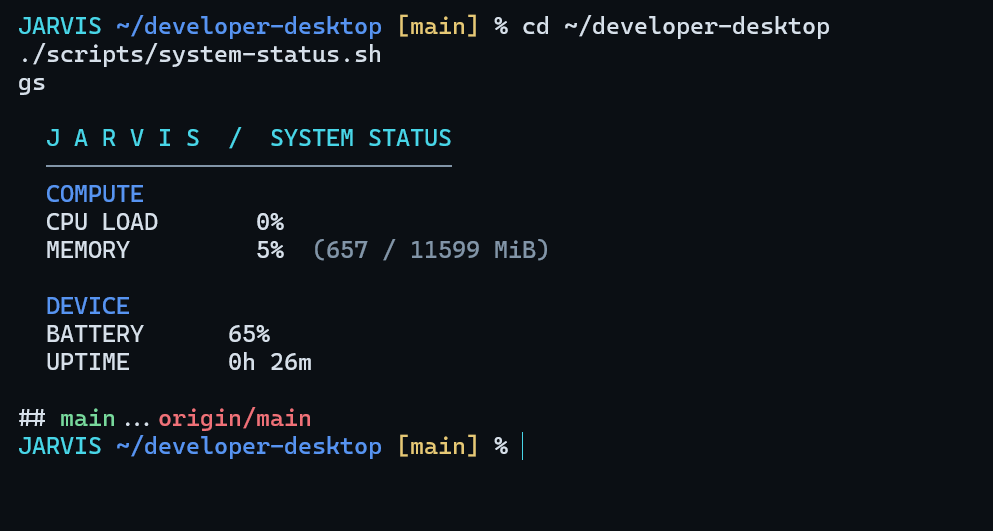

# JARVIS Developer Environment

A minimal, keyboard-oriented developer environment for Ubuntu on WSL2, inspired by the clean, restrained interface design of JARVIS.

The project combines a Git-aware Zsh prompt, fuzzy history search, useful shell shortcuts, and a lightweight system monitor in a consistent dark theme.

## Preview



## Features

- **JARVIS-inspired prompt:** Cyan label, directory path, and Git branch indicator.
- **Zsh configuration:** A reproducible shell setup with useful navigation and Git aliases.
- **Fuzzy search:** fzf integration for interactive history and search workflows.
- **System monitor:** CPU utilization, memory usage, battery status when available, and uptime.
- **Setup script:** Installs the configuration and backs up an existing Zsh configuration before replacing it.
- **Portable configuration:** Shell settings, scripts, tests, and documentation maintained in Git.

## Requirements

- Ubuntu on WSL2 or a compatible Linux environment.
- Bash and Git.
- Zsh and fzf.

The installer does not install operating-system packages. Install missing dependencies separately using your distribution's package manager.

## Installation

Clone the repository and enter the project directory:

```bash
git clone https://github.com/abhidash26/developer-desktop.git
cd developer-desktop
```

Run the installer:

```bash
chmod +x install.sh
./install.sh
```

Start Zsh:

```bash
zsh
```

Run the system monitor:

```bash
~/.local/bin/developer-status
```

The monitor command is a symbolic link to the script inside the cloned repository. Keep the repository in place while using it.

### Configuration backup

Before replacing an existing `~/.zshrc`, the installer saves a backup at:

```text
~/.config/developer-desktop-backup/zshrc
```

The backup is created only if one does not already exist at that location. Keep a separate copy of any custom shell configuration you cannot afford to lose.

## Shortcuts and aliases

| Command | Purpose |
|---|---|
| `ll` | Detailed directory listing |
| `la` | Show hidden files |
| `c` | Clear the terminal |
| `..` | Move up one directory |
| `...` | Move up two directories |
| `gs` | Short Git status |
| `gl` | Show recent Git commits |
| `gd` | Show unstaged changes |
| `gp` | Pull from the configured Git remote |
| `Ctrl-R` | Fuzzy history search when fzf integration is active |

## System monitor

Run the monitor directly:

```bash
./scripts/system-status.sh
```

The script reads Linux system interfaces to calculate CPU and memory usage, checks for battery information, and reports system uptime.

- CPU utilization is sampled over a one-second interval.
- Memory usage is calculated from total and available memory.
- Battery status is shown when the environment exposes it.
- CPU readings may vary between runs.

## Testing

Run the system monitor test:

```bash
./tests/test-system-status.sh
```

Check the shell configuration and script syntax:

```bash
zsh -n config/zshrc
bash -n scripts/system-status.sh
bash -n tests/test-system-status.sh
```

## Project structure

```text
developer-desktop/
├── config/
│   └── zshrc
├── docs/
├── screenshots/
│   └── jarvis-terminal.png
├── scripts/
│   └── system-status.sh
├── tests/
│   └── test-system-status.sh
├── install.sh
├── LICENSE
└── README.md
```

## Scope and limitations

This project currently targets the shell and terminal workflow inside WSL2. It does not independently configure a complete Linux desktop, window manager, application launcher, desktop status bar, or window decorations.

The terminal color scheme is configured separately in Windows Terminal. Additional desktop components would require a compatible desktop environment and further configuration.

## License

Released under the MIT License. See [LICENSE](LICENSE).
